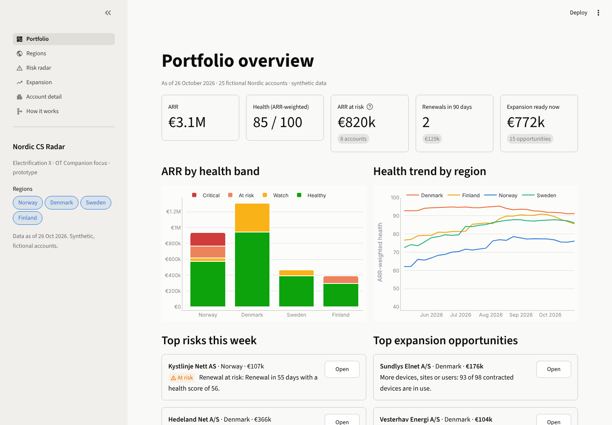

# Nordic Customer Success Radar

A prototype that shows how a Customer Success Manager for **Siemens Electrification X** in the Nordics
could spot two things automatically:

1. **Customers who may not be satisfied** (risk of churn or a weak renewal), and
2. **Customers ready for a next step** (expansion), based on usage and context.

The focus is **OT Companion**, the cybersecurity module. The other modules are included at a lighter
level because the strongest expansion paths cross modules: Asset Management → OT Companion,
OT Companion → SIEM.

> All companies, people, prices and figures are **fictional** and generated by a script.
> Which Siemens systems hold which data is an **assumption** (see "How it works" in the app).



## Run it

```bash
python -m venv .venv
source .venv/bin/activate          # Windows: .venv\Scripts\activate
pip install -r requirements.txt
python -m csm build                # generate data + compute health and signals
streamlit run app.py
```

The app opens at http://localhost:8501. If the database is missing, the app builds it on first start.

## What's in the dashboard

| Page | What it shows |
|---|---|
| **Portfolio** | ARR, ARR-weighted health, ARR at risk, renewals in 90 days, top risks and opportunities |
| **Regions** | Norway, Denmark, Sweden, Finland side by side: NIS2 status, concentration, partner share |
| **Risk radar** | Accounts ranked by priority, each signal with its reason and a suggested next step |
| **Expansion** | Opportunities by module with evidence, readiness, and a handover note for Sales |
| **Account detail** | Health breakdown and trend, modules, usage, OT Companion outcomes, relationship |
| **How it works** | Data sources, health formula, every rule and metric |

### Regional differences built in

- **Norway**: many accounts and open opportunities; NIS2 not yet in force, so it shows up as an upcoming trigger.
- **Denmark**: three large accounts. Risk priority is weighted by the account's share of its region's ARR,
  and a separate rule flags a key account that is no longer healthy.
- **Sweden**: mostly partner-led. A rule flags accounts Siemens hasn't met directly for six months,
  and playbooks tell the CSM to go through the partner.
- **Finland**: no specific insight yet; a mixed portfolio.

## How it works

```
Sources (CRM, Subscription Manager, platform telemetry, OT Companion, support, regulation)
   → SQLite source tables → metrics per account → health score (4 parts) → rules → dashboard + playbooks
```

- **Health score** (`csm/health.py`): onboarding 15%, adoption 35%, outcomes 30%, relationship 20%.
  The total stays within 15 points of the weakest part, so one strong area can't hide a broken one.
- **Rules** (`csm/rules.toml`): plain-text conditions such as `usage_change_pct <= -0.30`.
  Each rule carries its own explanation and next step. Change a threshold and run `python -m csm analyse`.
- **Expansion readiness** follows health: *Ready* (75+), *Check first* (60–75), *Fix value first* (below 60).

## Project layout

```
app.py              Streamlit dashboard
csm/schema.sql      Database tables
csm/generate.py     Synthetic Nordic portfolio (25 accounts, each built around a scenario)
csm/metrics.py      Metrics per account and date
csm/health.py       Health score
csm/rules.toml      Risk and expansion rules
csm/signals.py      Rule engine
csm/pipeline.py     Metrics → health → signals, saved to SQLite
csm/views.py        Data shaping for the dashboard
tests/              Checks that each scenario triggers the signals it was built for
```

Run the tests with `pytest`.

## From prototype to real data

Each source table mirrors what a real system would deliver. Moving to real data means replacing
`generate.py` with extracts (Salesforce API, Subscription Manager exports, platform usage data) that fill
the same tables. Metrics, rules and dashboard stay the same. In production, signals could also be
written back to Salesforce as tasks.
